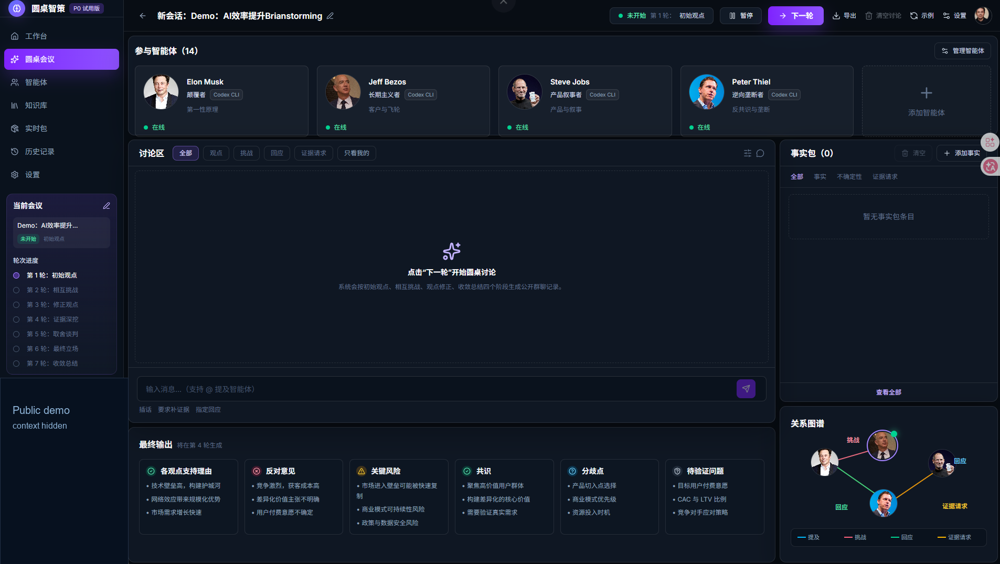
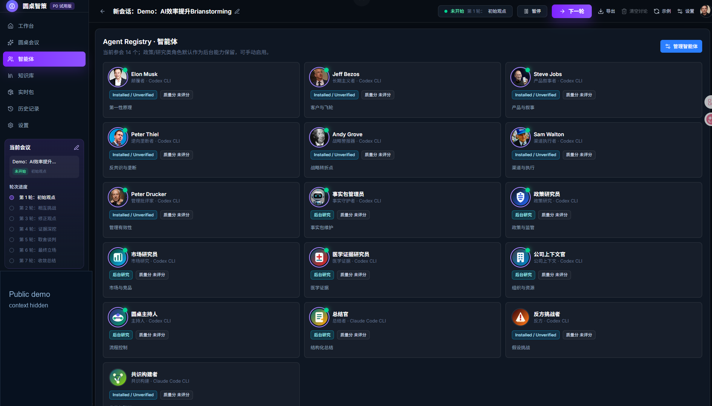

<div align="center">

# AgentHive - AI Roundtable Workspace / AI 圆桌智策工作台

**AgentHive 是本地运行的 executive AI workspace：面向创始人、产品负责人和商业策略团队，把一个业务问题交给可配置的多智能体圆桌，让不同 Agent 围绕观点、证据、风险和结论进行结构化讨论。**

[English](README.en.md) | [截图](#界面预览) | [快速开始](#快速开始) | [自定义-agent](#自定义-agent) | [隐私与边界](#隐私与边界)

**搜索意图：** 适合正在寻找 `AI roundtable`、`AI executive roundtable`、`AI advisory board`、`multi-agent strategy`、`多智能体讨论`、`AI 圆桌会议`、`商业策略 Agent`、`executive AI workspace` 的团队。

**快速开始：** 在仓库根目录运行 `.\Start-Roundtable-UI-Only.cmd`，然后打开 `http://localhost:3001/roundtable`。

**边界：** 本仓库提供本地 Next.js 工作台和可替换 Agent Skill 模板；真实业务材料默认留在本机 `context/`，仓库不包含 API key、Cookie 或登录凭据，商业领袖风格 Agent 不代表官方授权或背书。


</div>

---

##  AgentHive 是什么

AgentHive 不是一个固定角色的聊天机器人集合，而是一个面向策略讨论的 AI 圆桌运行时。你可以把一个 idea、会议纪要、业务背景材料或待决策问题放进同一个讨论场，让不同 Agent 按各自职责参与多轮发言。

它适合这些场景：

- 产品方向讨论：让产品、市场、执行、反方和总结 Agent 同场推演。
- 商业策略复盘：把会议纪要、销售数据、调研材料放进 `context/`，要求 Agent 标注事实边界和未证实假设。
- 决策前压力测试：让反方 Agent、事实包 Agent、政策研究 Agent 和行业研究 Agent 先提出风险和证据请求。
- Agent Skill 原型：用 `roundtable-skills/` 快速创建、替换或删除自己的角色模板。

> 重要说明：仓库内的商业领袖风格 Agent、事实包 Agent、政策研究 Agent、市场研究 Agent 等都只是可替换模板。用户可以自建、自定义、替换或删除任何 Agent。

##  项目定位

| 维度 | 说明 |
| --- | --- |
| 产品形态 | 本地运行的 Roundtable Web 工作台 |
| 核心对象 | 可配置 Agent、Skill、背景材料、讨论 Topic、证据请求、总结输出 |
| 默认前端 | Next.js 16、React 19、TypeScript |
| 默认入口 | `http://localhost:3001/roundtable` |
| 许可证 | Apache License 2.0 |
| 数据策略 | 真实业务材料默认放在本地 `context/`，不提交公开仓库 |

##  界面预览

### 圆桌讨论



### Agent Registry



##  核心能力

| 能力 | 说明 |
| --- | --- |
|  多 Agent 圆桌 | 支持商业领袖风格 Agent、专家 Agent、事实/证据 Agent、反方 Agent、总结 Agent 协同讨论。 |
|  角色可配置 | 每个 Agent 可配置名称、头像、职责、是否参会、是否后台研究和 Skill 文档。 |
|  Skill 模板 | `roundtable-skills/` 提供可复制、可改写的 Agent Skill 模板。 |
|  背景材料导入 | 支持从本地 `context/` 读取 `.md`、`.txt`、`.json`、`.jsonl`、`.csv` 等材料。 |
|  证据请求 | 讨论中可记录事实、未证实假设、不确定性和待验证问题。 |
|  讨论导出 | 支持导出完整讨论记录，并形成面向决策复盘的总结。 |

##  讨论工作流

```text
输入 Topic / 背景材料
        |
        v
选择或编辑参会 Agent
        |
        v
多轮圆桌讨论：观点、挑战、证据请求、风险
        |
        v
事实边界整理与未证实结论标注
        |
        v
导出讨论记录和决策总结
```

##  快速开始

### 方式一：Windows 启动脚本

在仓库根目录运行：

```powershell
.\Start-Roundtable-UI-Only.cmd
```

然后打开：

```text
http://localhost:3001/roundtable
```

### 方式二：手动启动

```powershell
cd workspace/frontend
npm install
npm run dev
```

默认地址：

```text
http://localhost:3001/roundtable
```

##  可选运行时

AgentHive 前端可以独立运行。若要让讨论 Agent 调用外部运行时，需要在本机额外配置对应 CLI：

| 运行时 | 用途 | 是否内置凭据 |
| --- | --- | --- |
| Codex CLI | Codex Agent 发言或执行本地任务 | 否 |
| Claude Code CLI | Claude Agent 发言或执行本地任务 | 否 |
| Tavily CLI | 联网检索和证据补充 | 否 |

请在自己的机器上单独安装、登录和管理这些工具。仓库不包含 API key、Cookie 或任何登录凭据。

##  项目结构

```text
AgentHive/
|-- context/                      # 本地背景材料目录，默认不提交真实业务资料
|-- docs/assets/screenshots/       # README 截图
|-- roundtable-skills/             # Agent Skill 模板
|-- scripts/                       # 启动脚本
|-- workspace/frontend/            # Roundtable Web 前端
|-- Start-Roundtable.cmd
`-- Start-Roundtable-UI-Only.cmd
```

##  自定义 Agent

你可以通过两种方式自定义 Agent：

1. 在前端 Agent Registry 中编辑 Agent 的名称、头像、职责、是否参会、是否后台研究等信息。
2. 在 `roundtable-skills/` 中新增目录，放入自己的 `SKILL.md`，再参考 `roundtable-skills/manifest.json` 注册该 Skill。

建议一个 Agent Skill 至少包含：

- 角色定位
- 讨论职责
- 判断原则
- 证据边界
- 输出风格
- 触发条件

##  隐私与边界

本仓库不包含真实业务数据、私有会议记录、API key、登录凭据或本机上下文文件。默认 `.gitignore` 会忽略：

- `context/*` 中的真实材料
- `.env` / `.env.*`
- `node_modules/`
- `.next/`
- 运行输出和日志

如果你要把自己的业务资料加入讨论，请放到本地 `context/` 目录，并确认不要提交到公开仓库。

##  免责声明

仓库中的商业领袖风格 Agent 是基于公开资料抽象出的 AI 讨论模板，仅用于产品原型和策略讨论研究。它们不代表任何真实个人或公司，也不构成真实个人或公司的授权、认可或背书。

##  MCP 图标验证

本 README 的正文图标统一使用 `better-icons` 检索确认过的 Lucide 线性图标 ID，并通过 Iconify URL 引用，保持同一图标库、尺寸和视觉重量。已验证的图标包括：

```text
lucide:brain-circuit
lucide:github
lucide:file-text
lucide:users-round
lucide:settings-2
lucide:book-open
lucide:database-search
lucide:search-check
lucide:download
lucide:workflow
lucide:rocket
lucide:square-terminal
lucide:box
lucide:shield-check
lucide:lock-keyhole
lucide:circle-check
```

同时已使用 `iconfont-mcp` 进行中文公开搜索和下载验证：搜索关键词为 `圆桌 讨论 证据`、`搜索`，下载验证文件为 `docs/assets/icons/iconfont-verification/iconfont-search-verification.svg`。为避免 README 混用图标风格，下载的 iconfont 图标未混入正文视觉系统。

##  License

Apache License 2.0. See [LICENSE](LICENSE).
